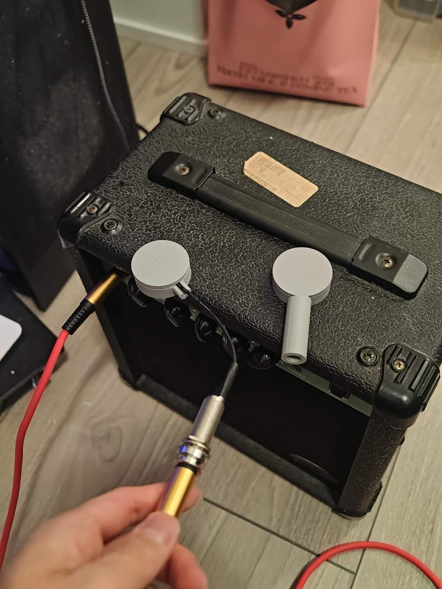

# Drumstick Controlled Music and Audio Processing

## Week 1 — Research and Initial Design

## Week 2 — Max Audio Processing and Rhythm Control
- Progress: We researched the Hybrid Drum project and planned a drumstick interface using piezo and motion sensors.
- Insights: We learned that piezo readings represent relative strike intensity.
- Next steps: Develop the circuit schematics and expand the Max patch.
- Roadblocks: The drumstick and sensor circuits have not been assembled.

## Week 3 — Group Formation and Project Planning
- **Progress:** We formed our project group and started discussing how to develop and implement our project. We explored the overall concept and possible technical approaches.
- **Next steps:** Finalize the project concept, divide responsibilities among group members, and research the hardware and software needed for implementation.
- **Roadblocks:** The project is still in the early planning stage, and we need to determine the technical requirements and implementation details.

## Week 4 — Research on AI-Based Sound Generation and Hardware Planning

- **Progress:** We started researching different approaches to sound generation and initially decided to explore the RAVE plugin in Max/MSP for AI-based audio synthesis and timbre transformation. We also conducted preliminary research on the required hardware components and created an initial equipment list for the project.
- **Insights:** We learned that RAVE (Realtime Audio Variational Autoencoder) can generate and transform audio in real time using trained neural networks, offering new possibilities for creating unique percussion sounds. We also gained a better understanding of the hardware requirements for capturing and processing piezo sensor signals.
- **Next steps:** Set up the RAVE plugin in Max/MSP, explore available pretrained models, finalize the equipment list, and begin acquiring the necessary components.
- **Roadblocks:** We are still in the research and planning stage. The required hardware has not yet been fully acquired, and RAVE has not been tested with the physical piezo sensor.

## Week 5 — Piezo Circuit and 3D Drumstick Design

- **Progress:** The piezo components arrived. We started designing a preamplifier circuit and a 3D-printable drumstick based on the piezo sensor's dimensions.
- **Insights:** We learned that piezo sensors require proper signal amplification and protection to capture vibration signals reliably.
- **Next steps:** Assemble and test the amplifier circuit, finalize the 3D drumstick model, and print the prototype.

## Week 6 — Piezo Circuit Assembly and Container Prototype

- **Progress:** We started assembling the amplifier and protection circuits. We also measured the piezo sensor's peak voltage, which reached approximately 18V, and designed the first version of the 3D-printable piezo container.
- **Insights:** We discovered that piezo sensors can generate high voltage spikes, making input protection essential. We also learned the importance of leaving enough space for wiring in the 3D design.
- **Next steps:** Continue testing the amplifier and protection circuits, revise the container to accommodate the wiring, and print an improved prototype.
- **Roadblocks:** The first container design did not leave enough room for the wires, preventing the lid from closing properly.

## Week 7 — Piezo Container Redesign and Drumstick Development

- **Progress:** We designed the second version of the piezo container lid and started developing the 3D-printable drumstick. We also continued assembling the amplifier and protection circuits. Additionally, we tested the piezo sensor by connecting it directly to an amplifier and speaker, and the results were promising.
- **Insights:** We learned how to improve the mechanical design by considering wiring space, component placement, and assembly requirements. The audio test also demonstrated that the piezo sensor can effectively capture vibrations and produce audible sounds.
- **Next steps:** Print and test the updated container and drumstick, complete the circuit assembly, and test the piezo sensor with the preamplifier.
- **Roadblocks:** The circuit assembly is still in progress, and the updated 3D-printed components have not yet been fully tested.

### Piezo Audio Test

We connected the piezo sensor directly to a guitar amplifier to test its ability to capture vibrations and produce sound. The results were promising.

## Week 8 — Max Development and Audio Troubleshooting
- **Progress:** We developed the Max prototype with playlist and microphone inputs, connected audio effects, rhythm controls, and recording. We also changed the interface to a basic Max style and organised the objects and patch cords.
- **Insights:** We learned how audio signals and control messages work together. Clearer connections make the processing chain easier to understand and troubleshoot.
- **Next steps:** Check the loaded audio file, DSP, volume, and output device settings to locate the no-sound problem. Then test microphone processing and prepare for sensor integration.
- **Roadblocks:** The Max patch is not producing sound in our current setup, and the cause has not been confirmed. The connection between the physical sensors and Max still needs testing.
## Week 9 — Simplifying the Max Patch and Comparing Audio

- **Progress:** We arranged the input, tone controls, recording, and output from left to right on one screen. We kept three tone knobs and added a way to record the same four seconds before and after processing.
- **Insights:** The new layout makes it easier to follow where the sound goes. Recording both versions of the same strike helps us hear what the tone controls change.
- **Next steps:** Test playback with the demo audio, then connect the piezo sensor and compare soft and hard strikes.
- **Roadblocks:** We still need to confirm that the updated patch plays sound on our setup and receives a clear signal from the piezo sensor.
